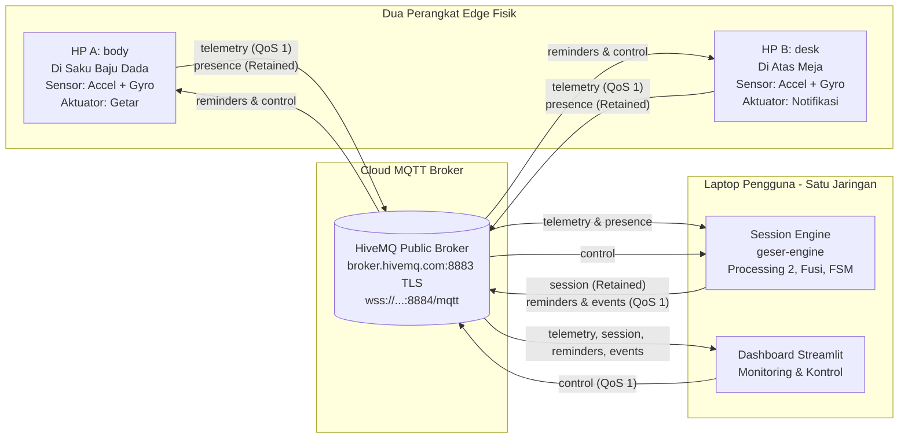
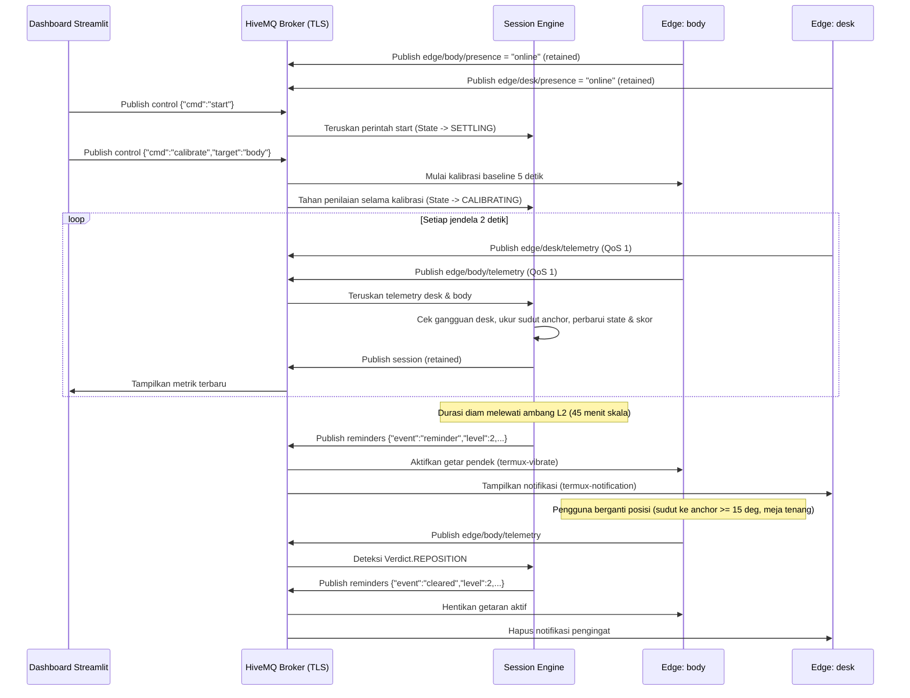
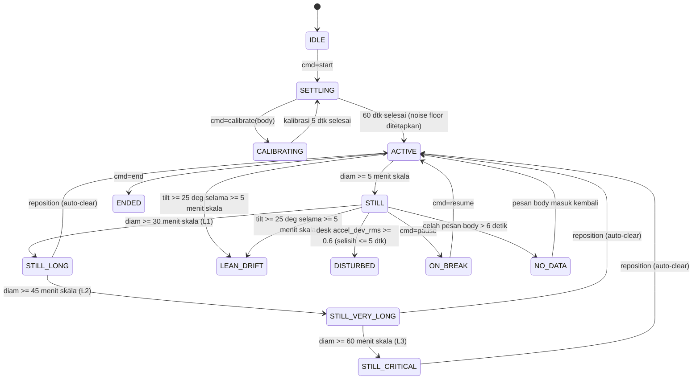

# Arsitektur Sistem & Spesifikasi Komunikasi GESER

> **Penafian:** Sistem hanya memperkirakan durasi diam dan kemiringan dari gerakan perangkat, bukan mengukur postur tubuh dan bukan alat medis.

---

## 1. Diagram Arsitektur Komponen



---

## 2. Diagram Urutan Komunikasi 2 Arah (Sequence Diagram)



---

## 3. Diagram State Machine Sesi



---

## 4. Tabel Topic MQTT (`geser/<PROJECT_ID>/...`)

| Topic | Arah | QoS | Retained | Fungsi |
|---|---|---|---|---|
| `edge/body/telemetry` | Edge `body` -> Engine, Dashboard | 1 | Tidak | Mengirim fitur hasil Processing 1 per jendela 2 detik dari saku baju. |
| `edge/desk/telemetry` | Edge `desk` -> Engine, Dashboard | 1 | Tidak | Mengirim fitur getaran dan kemiringan referensi meja per 2 detik. |
| `edge/body/presence` | Edge `body` -> Semua | 1 | Ya | Status `online` atau `offline` (dikirim otomatis oleh broker lewat *Last Will*). |
| `edge/desk/presence` | Edge `desk` -> Semua | 1 | Ya | Status `online` atau `offline` (dikirim otomatis oleh broker lewat *Last Will*). |
| `session` | Engine -> Semua | 1 | Ya | Status state machine, timer diam nyata & skala, skor, dan status node. |
| `reminders` | Engine -> Edge, Dashboard | 1 | Tidak | Pemicu pengingat (`reminder` L1..L3) dan pembatalan otomatis (`cleared`). |
| `events` | Engine -> Dashboard | 1 | Tidak | Catatan transisi status, kalibrasi, reposisi, dan perubahan kontrol. |
| `control` | Dashboard / CLI -> Engine, Edge | 1 | Tidak | Perintah kendali dua arah (`start`, `end`, `pause`, `resume`, `snooze`, `calibrate`, `time_scale`). |

---

## 5. Spesifikasi Payload JSON (Skema v1)

### A. Telemetry (`edge/<role>/telemetry`)
Hanya mengirim fitur per jendela 2 detik, bukan data mentah:
```json
{
  "v": 1,
  "device": "body",
  "run": "6af9e0c9",
  "n_msg": 42,
  "t_ms": 1790000000000,
  "window_s": 2.0,
  "samples": 20,
  "gravity": [0.02, -0.11, 0.99],
  "tilt_deg": 12.4,
  "tilt_step_deg": 1.1,
  "accel_dev_rms": 0.18,
  "gyro_path_rad": 0.05,
  "calibrated": true
}
```
**Aturan Validasi Ketat (`messaging/codec.py`):**
- Semua kunci wajib ada dan tidak boleh ada kunci tambahan.
- Nilai angka harus `finite`, vektor `gravity` harus ternormalisasi ($\|\mathbf{g}\| \approx 1.0 \pm 0.05$).
- Field `device` harus cocok dengan nama peran pada topic.
- `tilt_deg` bernilai angka hanya ketika `calibrated == true` (dan `null` bila `false`).
- Ditolak bila `|now_ms - t_ms| > 30000` ms (30 detik) atau `n_msg` tidak naik pada `run` yang sama (`SequenceGuard`).

### B. Session (`session`, Retained)
```json
{
  "v": 1,
  "state": "STILL_LONG",
  "reason": "Posisi sama melewati ambang level 1.",
  "active": true,
  "paused": false,
  "time_scale": 30.0,
  "still_real_s": 62.0,
  "still_scaled_s": 1860.0,
  "anchor_tilt_deg": 4.2,
  "reminder_level": 1,
  "last_reposition_ms": null,
  "score": 97,
  "nodes_online": {"body": true, "desk": true},
  "at_ms": 1790000062000,
  "reminders_count": 1,
  "repositions": 0,
  "longest_still_s": 1860.0,
  "lean_scaled_s": 0.0
}
```

### C. Reminders (`reminders`)
```json
{
  "event": "reminder",
  "level": 2,
  "message": "Sudah 45 menit tanpa ganti posisi. Berdiri dan regangkan badan sebentar.",
  "still_min": 45.0,
  "issued_ms": 1790000090000
}
```

### D. Control (`control`)
Hanya menerima perintah dalam *whitelist*:
- `{"cmd": "start"}`, `{"cmd": "end"}`, `{"cmd": "pause"}`, `{"cmd": "resume"}`
- `{"cmd": "snooze", "minutes": 5}` (pilihan: 5 atau 10)
- `{"cmd": "calibrate", "target": "body"}`
- `{"cmd": "time_scale", "value": 30.0}`
